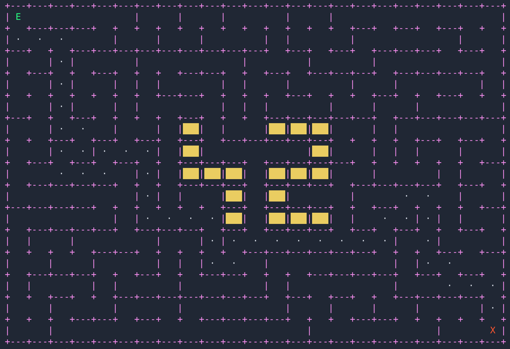

*This project has been created as part of the 42 curriculum by paduarte and alvespin.*

---
# a-maze-ing

<div align="center">
    
</div>
<br>

## Description

This project is part of the 42 curriculum and Milestone 2. The objective is to create a program that can generate a maze with given characteristics and produce a solution, as well as produce a visualization of them.

<br>

## Instructions

### Makefile targets

```bash
make install        # install the project dependencies
make run            # run the main script
make debug          # run the main script through the pdb debugger
make clean          # delete the extra folders
make lint           # run flake8 and mypy
make lint-strict    # run flake8 and mypy with strict rules
make venv           # create the virtual environment
make fclean         # delete the extra folders and the virtual environment
```

### Basic Usage

```bash
# Basic commands to run the program 
make venv
source .venv/bin/activate
make install
make run
```

### Mazegen package
The package files:
- *mazegen-1.0.0-py3-none-any.whl*
- *mazegen-1.0.0.tar-gz*

contain the maze generation module of the project, and can be installed in a different directory for use. They can be recreated by running this at the root of the repository:
```bash
python3 -m build -o .
```
If you want to use it on a different project, you can install them like this:
```bash
# Create a virtual environment in your project and install the package.
python3 -m venv .venv
source .venv/bin/activate
pip install mazegen-1.0.0-py3-none-any.whl
```


<br>

## Resources

- https://en.wikipedia.org/wiki/Maze_generation_algorithm
- https://www.youtube.com/watch?v=jZQ31-4_8KM
- https://www.datacamp.com/es/tutorial/a-star-algorithm
- https://www.datacamp.com/es/tutorial/manhattan-distance
- https://www.geeksforgeeks.org/python/priority-queue-in-python/
- https://github.com/Belladone-Bzz/A_maze_ing
- https://packaging.python.org/en/latest/guides/writing-pyproject-toml/


<br>

## Contents

### Algorithms

This project uses the Backtracking algorithm to generate the perfect maze. This was chosen because of its simplicity and guarantee that it will produce one single path between the entry and exit points. 

To create the non-perfect maze we first generate a perfect maze and then remove all of its dead-ends, thus opening more routes and making all its ends reachable.

To find the shortest path, the A* search algorithm has been chosen because it combines actual travel cost, an estimated heuristic goal cost, and guaranteed path optimality to explore fewer nodes than blind search methods.

### Project Structure

```
a-maze-ing/
├── maze_io/
│   ├── __init__.py
│   ├── parser.py
│   └── visualizer.md
├── mazegen/
│   ├── __init__.py
│   ├── cell.py
│   ├── mazegenerator.py
│   └── README.md
├── a_maze_ing.py
├── config.txt
├── requirements.txt
├── Makefile
├── LICENSE.md
├── README.md
├── pyproject.toml
└── .gitignore
```

### Requirements

The dependencies of the project are stored in *requirements.txt*.
```bash
mypy    # To examine the code
flake8  # To examine the code
build   # For building the mazegen package
numpy   # For handling the maze grid as an np array
```

### Configuration file

The parameters of the maze are parsed from *config.txt*.
```
WIDTH=23
HEIGHT=12
ENTRY=11,0
EXIT=19,11
OUTPUT_FILE=maze.txt
PERFECT=True
SEED=42
```

<table>
    <thead>
        <tr>
            <th></th>
            <th>Key</th>
            <th>Type</th>
            <th>Range</th>
        </tr>
    </thead>
    <tbody>
        <tr>
            <td rowspan=7 align="center"><b>Mandatory<br>values</b></td>
        </tr>
        <tr>
            <td>WIDTH</td>
            <td>Number of columns of the maze</td>
            <td>Integer from 9 to 42</td>
        </tr>
        <tr>
            <td>HEIGHT</td>
            <td>Number of rows of the maze</td>
            <td>Integer from 7 to 42</td>
        </tr>
        <tr>
            <td>ENTRY</td>
            <td rowspan=2>Coordinates: two numbers separeated by a comma</td>
            <td>Integer from 0 to WIDTH - 1</td>
        </tr>
        <tr>
            <td>EXIT</td>
            <td>Integer from 0 to HEIGHT - 1</td>
        </tr>
        <tr>
            <td>OUTPUT_FILE</td>
            <td>Where the results will be saved</td>
            <td>filename</td>
        </tr>
        <tr>
            <td>PERFECT</td>
            <td>Whether the maze is perfect</td>
            <td>True / False</td>
        </tr>
        <tr>
            <td rowspan=2 align="center"><b>Optional<br>values</b></td>
        </tr>
        <tr>
            <td>SEED</td>
            <td>Change the seed of all randomization during the maze's generation.</td>
            <td>Integer > 0</td>
        </tr>
    </tbody>
</table>

### Output file

The module's *save()* function will write the structure and a solution to the maze to a file.

#### Layout
```
b9157913d13953d55157    # Maze grid (hexadecimal)
aea956ac56c6d4553853
c3aa97af953fff956c3a
ba86a96fc7857fad13aa
...

0,0                     # Entry point
18,7                    # Exit point
SSESSWSESESENENENNE...  # Shortest path (N/E/S/W)
```
#### Wall enconding
```
                W S E N   Hex
      N         0 0 0 0    0    # All walls open
    +---+       0 0 0 1    1    # Only North closed
  W |   | E     0 0 1 0    2    # Only East closed
    +---+       0 1 1 0    6    # East and South closed
      S         1 0 1 1    b    # Only South open
                1 1 1 1    f    # All walls closed
```


<br>

## Example

Example of the mazegen module being used independently.

### Script
```python
# Import the module
from mazegen import MazeGenerator

# Instantiate the generator, with a basic example input.
# In order: width, height, entry, exit, perfect and seed
M = MazeGenerator(15, 10, (0,0), (14,9), True, 0)
# Generate the maze and the solution.
M.generate()
# Save the maze and its parameters to a file.
M.save('maze.txt')
```
### Output
```
d39539555395553
96abaab956a93d2
c56ac6aad542c3a
9512f92afffa96a
a96afec057fea96
aad6fffafff96c3
ac5553fafd52d3a
c3d396fafff83aa
9692c17c53d6aaa
c56c7c5554556c6

0,0
14,9
ESWSEENNEESSENNEEEESWWSSSSSSSEESEEENNWNNENNENWNWSWNNEEEESSSSWSESSSS
```


<br>

## Project Management

### Planning

- **Our initial split**: We began by generating a list of tasks and assigning the more complex ones—such as the maze generation algorithm and the Mazegen package—to Alvespin, the most experienced member. Meanwhile, we assigned tasks better suited to a lower level of experience—such as parsing and rendering—to Paduarte.

- **The roles of each team member**:<br>
Alvespin took the lead role, as he had a better overall vision of the project and more experience with the most complex parts of the implementation, while also helping with architectural decisions and solving problems that affected different parts of the project.<br>
Paduarte also worked on integrating the different components and debugging issues between modules. As the project progressed, he became more independent, allowing both members to work on different parts of the project simultaneously.

- **Our anticipated planning and how it evolved until the end**:
There was good initial planning, so the assignment and execution of tasks were collaborative and seamless from start to finish.

- **What worked well and what could be improved**:
Aiming to balance the workload for each member based on their current knowledge was a very good decision. 
With more time, we could have implemented a graphical display using the MiniLibX (MLX) library instead of ASCII rendering.

- **Have you used any specific tools? Which ones?**:
We worked primarily with Git. The task list was kept in a .md file within the project, but otherwise, we worked by being physically together.
We have made use of AI to clarify concepts and debug errors.

### Contributions by each member

|alvespin|paduarte|
|:------|:------|
|<ul>    <li>Cell and maze classes</li><li>Perfect and imperfect<br> maze generation algorithms</li><li>Output file creation<br>and format</li>    </ul>|<ul>    <li>Configuration file parsing</li><li>ASCII representation</li><li>Interactive menu</li><li>Path finding algorithm</li><li>Seed handling</li>    </ul>|

### Further modifications

This repo contains changes made by *alvespin* after the project's submission.

- *parser.py* and *visualizer.py* moved to their own module folder. Previously standalone files.
- The user can type 'max' in place of an integer in a coordinate value to get the maximum value posible, taken directly from the WIDTH or HEIGHT.
- Animation ...
- change perfect on menu ...

<!--
##### Mandatory values
|   | Key     | Format |
|---|---------|--------|
| `WIDTH` | Positive integer above 9 |
| `HEIGHT` | Positive integer above 7 |
| `ENTRY / EXIT` | Positive integers forming coordinates like (x,y). Max value is width or height - 1. |
| `OUTPUT_FILE` | Where the results will be saved |
| `PERFECT` | Either True or False |
#### Optional values
| Key | Format |
|-----|--------|
| `SEED` | Positive integer. Change the seed of all randomization during the maze's generation |
-->
